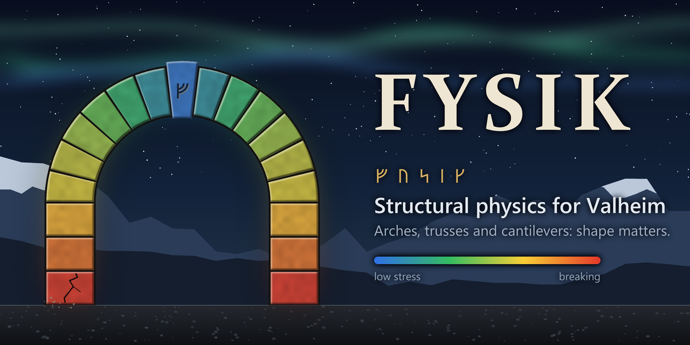

# Fysik

**Structural physics for Valheim building.** Fysik ("physics" in Swedish and Danish) replaces Valheim's
vanilla structural integrity, where a piece only cares about its distance to the ground, with a force
calculation in which the **shape** of a build matters: arches work in compression, triangulated
trusses stay rigid, cantilevers bend, and stone rests on stone like real masonry. Overloaded pieces
crack, shake and creak for a few seconds before they fall, so there is time to shore them up.

Gameplay references: Poly Bridge, Bridge Constructor.

Players: installation and settings are in the [package README](package/README.md); the
**building guide** with worked examples, what weighs, how to read the forces, server notes and a FAQ
are in the [wiki](https://thunderstore.io/c/valheim/p/menezesbruno/Fysik/wiki/) (sources in
[docs/wiki](docs/wiki)).

> **Status: early access.** Fysik computes the forces, shows them (hammer colors, X-ray view,
> placement preview) and decides what falls: overloaded pieces crack, then fall. Material values are
> still being calibrated.

## How it works

- **Solver:** linear 3D frame analysis (K·u = F, sparse stiffness matrix, conjugate gradient) on each
  connected island of up to `Structure.MaxFrameBodies` pieces (2000 by default, up to 5000); a
  simplified load-path model above that. Each piece is a rigid body with 6 degrees of freedom; each
  joint is an elastic connection whose stiffness comes from the two pieces' cross-sections between
  their centres and the contact point, each segment treated as a Timoshenko cantilever (stretching,
  shear, bending and twisting, with the rotation a sideways push causes). The contact point is the
  centre of the overlap between the two pieces, and the force a joint carries is spread over that
  overlap: across a face or along an edge (a wall on a wall, a floor on a beam, a piece on the ground)
  the pressure varies linearly, as in a real bearing; over a short contact it is spread evenly. The
  ground under a piece is one support per contiguous patch it touches. Stresses are then checked on
  cuts across every piece, so a beam resting on a post in the middle still sees its own bending.
- **Connections:** every pair of touching pieces is a rigid joint, except stone on stone (stone,
  black marble, grausten), which is a masonry joint: it carries no tension, carries compression only
  while the resultant stays inside the contact area, and holds sideways by friction (0.6). The solver
  repeats the calculation, opening joints in tension, turning joints whose resultant leaves the
  contact into hinges at the edge and letting overpushed joints slip, until nothing changes; a part
  that can then move freely (detected by solving again with the released joints ten times softer:
  only a mechanism moves ten times more) is unstable and falls, while the rest is solved without it.
  Stone on other materials and on the ground stays rigid. Walls and floors are approximated
  as equivalent beams. Loads: self-weight, plus what rests on a piece. Pieces the game tags as
  structure (building, floor, wall, roof, architecture, stairs, doors) weigh their volume times their
  material's density; pieces it tags as objects (furniture, crafting, lighting, decor, storage,
  transport, defense, food) weigh what they are made of, since their colliders are not solid material:
  4 kg per piece of wood, 10 kg per stone, 4 kg per metal bar, 0.1 kg per nail, and 2 kg per unit of
  item weight for anything else (server settings in the `Weight` section). Piles and stacks weigh
  their items as stored items do, 1 kg per unit of item weight (`Weight.Contents`). Simple buckling:
  slender pieces get a lower compression limit. Pieces that hold nothing up (chests, workbenches,
  torches, most piles) weigh by the same rules, as a load shared among the pieces they rest on (the
  ground takes its share when they also touch it) and spread over each of those pieces; as in vanilla,
  they need a structural piece or the ground to rest on, and fall without one.
- **Loads beyond the pieces:** what is inside a chest, a cart or a player's inventory weighs 1 kg per
  unit of item weight (the game's weights read as kilograms). A player weighs 80 kg plus their
  inventory, on the piece they stand, sit or lie on; a cart weighs its materials plus its cargo,
  shared among the pieces under its wheels. The owner of each player or cart writes the pieces it
  rests on and its weight into its ZDO, so every client solving a structure sees the same moving
  loads. Deep North snow (the game's own buildup, synced in each piece's ZDO, in quarter steps) weighs
  150 kg/m² at full depth over the piece's plan area, times a roof shape factor (0.8 up to 30°, down
  to 0 at 60°); pieces the game makes immune to heavy snow and worlds without heavy snow hold none,
  and vanilla's snow damage is off in Physics and Sandbox modes. A change in these loads re-solves the
  island while its last result stays in use, so moving loads never leave a structure without a result.
  `Weight.LiveLoads` (on by default) switches all of these loads off at once.
- **Failure:** an overloaded piece cracks before it falls, for `Failure.CrackWarningSeconds` (5 s)
  when it is just past its limit (up to 110%), shorter the further past, none from 200%. A piece with
  no path to the ground falls at once. Whatever loses its support falls with the piece that gave way,
  and for 3 s afterwards overloaded pieces of the same structure fall without warning (cascade).
- **Fysik's own pieces:** arch stones (wedges in seven sizes, 4 to 16 m spans), tower stones
  (curved, 22.5°, for towers 4 to 10 m across, in two thicknesses, with half stones) and stone walls
  and floors 0.5 m thick, cloned from the vanilla stones with their meshes reshaped in code. Each
  special stone is solved as a box of its true volume (a tower stone's box stays inside its curve).
  Player-built stone blocks overlapping an arch or tower stone, and wooden panels (floors, wall
  panels, roofs; never beams, poles or logs) overlapping a tower stone, are cut to fit around it on
  a worker thread (mesh, collider and weight; a cut piece keeps its near level of detail at any
  distance, as the game's far meshes cannot be read). Arch and tower stones are turned back to their
  designed angles when they load, since the game saves rotations in half-degree steps. Placement
  helpers lay the next arch or tower stone along its curve and a thin floor on top of a wall.
- **World buildings:** buildings that come with the world (stone towers, abandoned houses, villages,
  ruins: every piece no player placed) do not get Fysik's physics. They keep vanilla support, are
  shown in neutral grey, and a player build resting on them treats them as fixed ground; only player
  builds are simulated directly. The server setting `Structure.WorldBuildings = Physics` simulates
  them too, with the normal stress colors; many were not designed for it and will fall.
- **Materials:** wood < core wood < stone / iron. Stone is strong in compression and weak in tension.
  Unknown materials from other mods get safe defaults and a log warning.
- **Multiplayer:** only players calculate. Whoever owns a piece (the player near it, as in vanilla)
  solves the whole structure and decides its fate; the calculation is deterministic, so owners of
  different parts of one structure agree, and the crack is synced through the piece's ZDO. The
  dedicated server calculates nothing: it relays, syncs the settings (Jötunn) and hands the pieces
  near the world centre, which it would otherwise keep, to the nearest player. Every player must have
  the mod (`CompatibilityLevel.EveryoneMustHaveMod`).
- **Performance:** recalculation only on events (piece placed, removed or damaged, an object placed
  on it or taken away, a chest's contents changed, a player or cart moving onto another piece, snow
  building up or shoveled off, a weight or material setting changed), only on the affected island.
  Scanning contacts and reading the pieces stay within `Performance.FrameBudgetMs` (1.5 ms) per
  frame; the solver is set up and run on a worker thread (a base of 850 pieces in about half a
  second), and pieces cut to fit an arch or a tower are carved on worker threads, one mesh per core,
  then swapped in on the main thread.

## Roadmap

Next:

- Conical roofs for round towers
- More arch stones (cut from the 2×1 stone), and grausten and black marble blocks cut around arches
  and towers
- Creatures' weight (tamed lox, trolls) on bridges and floors

Later:

- Calibration with player builds (feedback welcome)
- Faster recalculation for very large bases
- Translations into every language Valheim supports
- A website to plan and test a build in the browser with the same solver

## Building from source

Requirements: Windows, Valheim, [r2modman](https://thunderstore.io/c/valheim/p/ebkr/r2modman/) with a
profile that has BepInExPack_Valheim and Jötunn, and the .NET SDK (any recent version; the project
targets .NET Framework 4.6.2 through reference assemblies).

1. Copy `Environment.props.example` to `Environment.props` and set:
   - `ValheimDir`: the game folder (contains `valheim_Data\Managed`).
   - `DevProfileDir`: an r2modman profile **dedicated to testing** (e.g. `Fysik-Dev`). It provides the
     BepInEx and Jötunn references and receives Debug builds. The build refuses to deploy to a profile
     named `Default`.
2. Build:

   ```sh
   dotnet build -c Debug                                   # builds and copies Fysik.dll + .pdb to <profile>/BepInEx/plugins/Fysik
   dotnet test tests/Fysik.Tests                           # solver tests (no game needed)
   dotnet build src/Fysik/Fysik.csproj -c Release -t:Package   # creates dist/Fysik-<version>.zip for Thunderstore
   ```

3. Start the game through the test profile (r2modman: select the profile, then *Start modded*) and
   look for `Fysik <version> loaded` in `<profile>/BepInEx/LogOutput.log`.

The version lives only in `src/Fysik/Fysik.csproj` (`<Version>`); it feeds the plugin attribute
(through `BepInEx.PluginInfoProps`) and the Thunderstore `manifest.json`. `assembly_valheim` is
publicized at build time (`BepInEx.AssemblyPublicizer.MSBuild`), so private game members can be used
directly. Game and third-party DLLs are referenced in place and never committed.

### Repository layout

| Path | Contents |
|---|---|
| `src/Fysik/Structure/` | The solver: pure C#, no Unity types, shared with the tests |
| `src/Fysik/Game/` | Valheim side: piece graph, contacts, display, patches |
| `tests/Fysik.Tests/` | Solver tests: beam theory (cantilever, fixed beam, column, arch, brace, floor on a beam), plates, loads meeting at a piece's centre, stacked stone walls, contact overlap and contact areas, masonry joints (tipping, sliding, arches with and without their keystone), arch stones and stone blocks cut around them, tower rings (closing, courses, towers and rounded corners standing, a stone's block inside its curve) and walls and wooden floors cut around them, a wall cut to fit a tower resting on it without hanging from it, wooden panels told from beams, angles kept through a world save, floors laid on walls, weight held, squeeze along a piece, snow on roofs, damage, crack policy and warning, performance |
| `package/` | Thunderstore `manifest.json` template and the package README |
| `art/` | `icon.png` and `banner.png` |
| `docs/images/` | The building guide's pictures |
| `docs/wiki/` | Sources of the Thunderstore wiki pages, one per file, in the order they appear |

### Releasing on Thunderstore

Run the `Package` target and upload `dist/Fysik-<version>.zip`. The package is listed under
**Mods**, **Tweaks**, **Server-side**, **Client-side**, **Building** and **Deep North Update**. Update
`CHANGELOG.md` before each release. When a page in `docs/wiki/` changes, paste it into the package's
wiki on Thunderstore: the first line, without the `#`, is the page title (numbered, since Thunderstore
lists pages alphabetically), and the rest is its content.

## License

Copyright (c) 2026 Bruno Menezes. Fysik is free software under the [GNU General Public License
v3.0](LICENSE): you may use, change and share it, and whatever you distribute that is built on it must
be released under the same license, with its source code. Versions up to 0.1.5 were released under
the MIT license.
